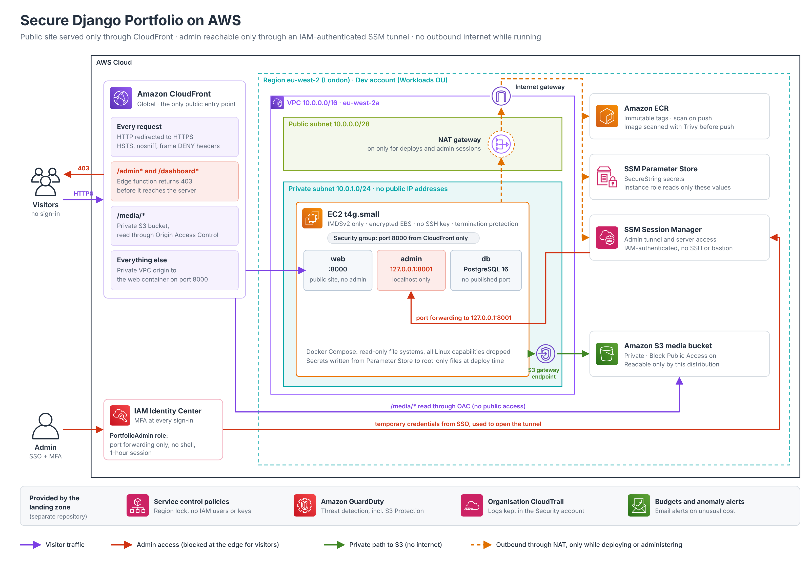

# Secure Django Portfolio on AWS

A Django portfolio site deployed on AWS with no public server and no admin page on the internet. Visitors reach the site only through CloudFront. The admin is reachable only through an IAM-authenticated SSM tunnel. The server has no outbound internet access while it runs.

**Live site:** [d1h0161c4e9gfm.cloudfront.net](https://d1h0161c4e9gfm.cloudfront.net). Try [`/admin/`](https://d1h0161c4e9gfm.cloudfront.net/admin/) to see the edge block (403).

**Evidence:** screenshots of every control working are in the [evidence gallery](docs/evidence/README.md), starting with [what a guest can reach and how the admin gets in](docs/evidence/README.md#live-site-guest-and-admin).

The site runs on a separate multi-account platform: [aws-landing-zone](https://github.com/emmanuelal99/aws-landing-zone). What the portfolio expects from that platform is listed in [platform-dependencies.md](docs/platform-dependencies.md).

## Architecture



The diagram source is [architecture.svg](docs/architecture.svg).

## Security controls

| Control | How | Evidence |
|---|---|---|
| No public server | EC2 in a private subnet with no public IP. Inbound only through a CloudFront VPC origin. | [Guest requests](docs/evidence/README.md#live-site-guest-and-admin), [instance with no public IP](docs/evidence/README.md#server-and-network) |
| Only CloudFront can reach the app | Security group allows port 8000 from the CloudFront VPC origin service group only | [Security group](docs/evidence/README.md#server-and-network) |
| HTTPS only | CloudFront redirects HTTP to HTTPS | [301 for `http://`](docs/evidence/README.md#live-site-guest-and-admin) |
| Security headers | HSTS, `nosniff`, `X-Frame-Options: DENY`, referrer policy, set at the edge | [Headers policy](docs/evidence/README.md#edge-protection-cloudfront) |
| Admin not on the internet | An edge function returns 403 for `/admin` and `/dashboard`. The public container does not contain the admin. The admin container listens on localhost only. | [403 at the edge](docs/evidence/README.md#live-site-guest-and-admin), [404 from the public container](docs/evidence/README.md#admin-isolation-on-the-server) |
| Admin access needs IAM | SSM port forwarding with a role that cannot open a shell | [Tunnel and admin pages](docs/evidence/README.md#live-site-guest-and-admin) |
| Private media | S3 bucket readable only by this CloudFront distribution (OAC), HTTPS only | [Bucket settings and policy](docs/evidence/README.md#media-bucket), [P-002](docs/findings.md#p-002-media-images-did-not-load-through-cloudfront) |
| No outbound internet at runtime | NAT gateway created for deployments only, then removed | `curl` returns 200 with the NAT gateway and Elastic IP removed |
| Secrets out of code | Parameter Store SecureString values, written at deploy time to root-only files | [Root-only files](docs/evidence/README.md#secrets) |
| Hardened instance | IMDSv2 only, encrypted volume, no key pair, termination protection | [Instance hardening](docs/evidence/README.md#server-and-network) |
| Hardened containers | Read-only file system, all Linux capabilities dropped, `no-new-privileges` | [`compose.prod.yaml`](compose.prod.yaml), [ports](docs/evidence/README.md#admin-isolation-on-the-server) |
| Image supply chain | Immutable ECR tags, scan on push, Trivy before push, Dependabot | [ECR scan](docs/evidence/README.md#container-image), [image-scan.md](docs/image-scan.md) |
| Least-privilege instance role | Read only its own parameters, its own bucket, pull only its own image | [Role and policies](docs/evidence/README.md#instance-role-and-permissions) |

## Deployment

1. Build the image for arm64, scan it with Trivy, and push it to ECR with an immutable tag.
2. Turn the NAT gateway on (`nat-on.sh` in the landing zone).
3. Open an SSM session to the instance.
4. `sudo ./fetch-secrets.sh` writes the environment files from Parameter Store.
5. `docker compose -f compose.prod.yaml up -d` starts the web, admin and database containers.
6. Run database migrations in the admin container.
7. Turn the NAT gateway off (`nat-off.sh`).

## Infrastructure as code

All AWS resources for the workload are in [terraform/main.tf](terraform/main.tf), in their own Terraform state, separate from the landing zone. The network is read from the landing zone with data sources and is never managed here.

- Resources refer to each other instead of using typed IDs. For example, the bucket policy uses the distribution's ARN, which prevents the mistake in finding P-002.
- Parameter Store values are not managed by Terraform, so secrets never reach the state file.
- The environment was imported with a read-only role, and every import was checked to show no changes first. The method is described in the landing zone's [D-008](https://github.com/emmanuelal99/aws-landing-zone/blob/main/docs/design-decisions.md#d-008-how-the-existing-environment-was-brought-into-terraform).

## Findings

[findings.md](docs/findings.md):

- **[P-001](docs/findings.md#p-001-session-manager-not-ready-straight-after-the-nat-is-turned-on):** after the NAT gateway was turned on, the instance showed `Online` but sessions were refused. The SSM agent's session channel reconnects separately from its status channel.
- **[P-002](docs/findings.md#p-002-media-images-did-not-load-through-cloudfront):** media images failed for two reasons: the S3 origin used the global endpoint (307 and a region error), then the bucket policy had a `0` where the distribution ID has the letter `O` (403). Both were diagnosed from the response headers and error codes.

## Security review

The workload's resources were scanned with Prowler and every finding was triaged ([prowler-triage.md](docs/prowler-triage.md)). The scan screenshots are in the [landing zone evidence](https://github.com/emmanuelal99/aws-landing-zone/blob/main/docs/evidence/README.md#security-review-prowler), because the scan covered the whole Dev account. Most open items share one cause, the default `*.cloudfront.net` certificate, and are deferred until a custom domain is added.

## Not yet in place

- Custom domain with an ACM certificate (would also raise the minimum TLS version)
- AWS WAF in front of CloudFront
- Daily EBS snapshots for the database volume

## Repository structure

```
portfolio_site/       Django project
compose.prod.yaml     Production containers: web, admin, db
fetch-secrets.sh      Writes environment files from Parameter Store
admin-tunnel.sh       Opens the SSM port forwarding tunnel to the admin
terraform/            Terraform for the workload's AWS resources
docs/                 Findings, Prowler triage, image scan, platform dependencies
docs/evidence/        Screenshots of each control, with private details covered
docs/architecture.*   Architecture diagram (PNG, with SVG source)
```
